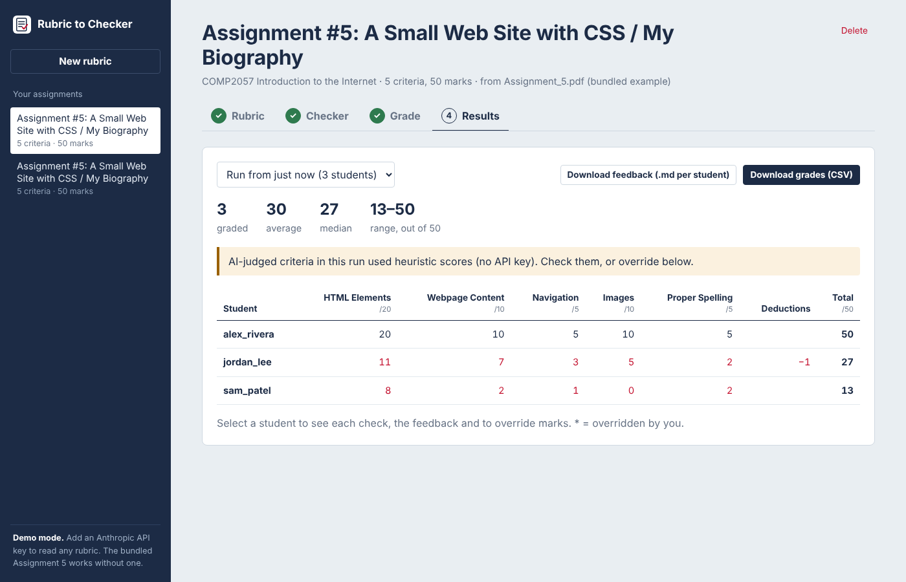
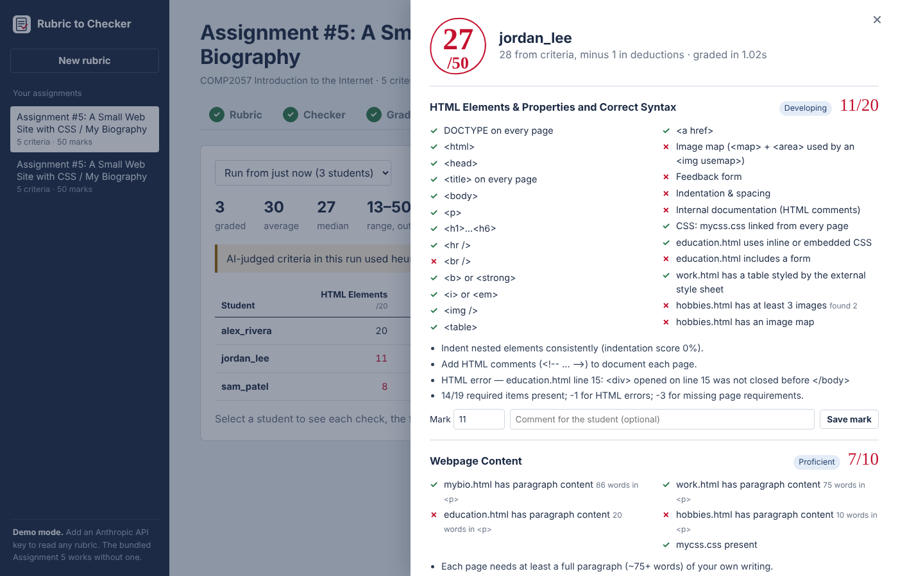

# Rubric to Checker

**Upload a marking rubric. An AI agent writes a Python grading script for it, tests and repairs that script, then grades every HTML/CSS/JavaScript submission and explains every lost mark.**

Built as a portfolio project. It ships with a real course rubric (COMP2057 Assignment 5: a four-page portfolio site with CSS), a reference checker and three sample students, so it runs end to end without an API key.




---

## How the agent works

```
 rubric.pdf ─► 1. PARSE      Claude reads the PDF (layout + text) → structured rubric JSON
                             (criteria, mark bands, required files, page requirements)
                             └─ you review / edit it in the UI
            ─► 2. GENERATE   Claude writes checker.py against the gradekit API
            ─► 3. VALIDATE   AST safety scan → run in sandbox on an EMPTY submission
                             → run on 1–3 SAMPLE submissions → check the result contract
                             (every criterion present, right max marks, no crashes)
                 ▲     │ problems (tracebacks, contract violations)
                 └─ 4. FIX ◄─┘ up to MAX_FIX_ATTEMPTS rounds
            ─► 5. REVIEW     Claude compares the sample marks with the rubric and fixes
                             real grading bugs (only kept if the fix still validates)
            ─► 6. GRADE      checker runs per student in the sandbox; criteria marked
                             `ai_review` (spelling, writing quality…) go to an AI judge
            ─► 7. REPORT     gradebook, per-check feedback, overrides, CSV + feedback .md
```

Design decisions worth talking about in an interview:

- **The agent writes code; it doesn't grade by vibes.** Objective criteria (tags present, links work, file sizes, CSS rules) are decided by deterministic Python, so the same submission always gets the same marks and every mark can be traced to a check. The LLM only judges what really needs judgement, through an explicit `c.ai_review(...)` hook, and its result is clamped to the rubric range.
- **A small domain library (`gradekit/`) makes the generated code short and reliable.** It covers HTML parsing and a lenient validator, indentation scoring, CSS parsing via tinycss2, static JS analysis via esprima, link resolution that catches case mismatches which only break on Linux web servers, image size checks, and alt-text quality. The model receives `gradekit/API.md` and one complete example checker as its spec, and that system prompt is cached across the fix loop.
- **A result contract plus per-criterion isolation.** Each criterion runs inside `with report.criterion(...)`, so a bug in one criterion scores it 0 and flags it for review instead of losing the whole report. The validator checks the contract and feeds violations back to the model.
- **Untrusted code on both sides.** Generated code passes an AST allow-list (no `os`, `subprocess`, `open`, `eval`, dunder access…). It then runs in a separate process with a scrubbed environment (no API key), CPU, memory and file-size limits, and a timeout. Student JavaScript is parsed, never executed. Student text sent to the judge is wrapped and labelled as data.
- **Messy real-world uploads.** Supports a folder of student folders, a zip of zips, LMS exports with a zip inside each student folder, and wrapper directories. Zip extraction blocks path traversal and zip bombs.
- **The human stays in charge.** You can edit the parsed rubric, give the agent instructions ("navigation is too strict"), edit the code yourself (it's re-validated and saved as a new version), roll back versions, and override any mark with a comment.

## Quick start

```bash
python -m venv .venv && source .venv/bin/activate      # Windows: .venv\Scripts\activate
pip install -r requirements.txt
cp .env.example .env            # add your ANTHROPIC_API_KEY (optional for the demo)
python examples/make_samples.py # builds the 3 sample students + class zip
python run.py                   # http://localhost:8000
```

Click **Try it with a sample assignment**, then **Grade the 3 sample students**.
With an API key you can upload any rubric (PDF, DOCX, TXT, MD, HTML).

### Grading your own folder of assignments

In the UI, open **Grade**, then **Choose a folder**, and pick the folder that contains one sub-folder (or zip) per student.

Or from the command line, with no server:

```bash
# rubric -> rubric.json + checker.py (tested on up to 3 of your submissions)
python -m app.cli build path/to/rubric.pdf --samples path/to/assignments --out a5

# grade everything -> a5/results/grades.csv, results.json, feedback/<student>.md
python -m app.cli grade path/to/assignments --checker a5/checker.py --rubric a5/rubric.json --out a5/results

# change the checker in plain English
python -m app.cli rebuild a5/rubric.json --checker a5/checker.py \
    --instructions "Accept .htm as well as .html" --samples path/to/assignments --out a5
```

## Configuration (`.env`)

| variable | default | |
|---|---|---|
| `ANTHROPIC_API_KEY` | – | without it the app runs in demo mode (bundled rubric only, heuristic scores for AI criteria) |
| `CHECKER_MODEL` | `claude-sonnet-5-5` | parses rubrics and writes and fixes checkers. `claude-opus-5-5` gives the strongest code. |
| `JUDGE_MODEL` | same as above | scores `ai_review` criteria. `claude-haiku-5-5` is a cheaper option for large classes. |
| `MAX_FIX_ATTEMPTS` | `3` | self-repair rounds |
| `REVIEW_PASS` | `1` | self-review of sample results |
| `GRADE_CONCURRENCY` | `4` | students graded in parallel |
| `CHECKER_TIMEOUT` | `90` | seconds per student |
| `DEMO_ONLY` | `0` | force demo mode, for example on a public portfolio deployment where you don't want visitors spending your API credits |

## Project layout

```
app/
  agent.py      the agent: parse → generate → validate → fix → review
  sandbox.py    AST allow-list + resource-limited subprocess runner
  grader.py     batch grading, AI judge, overrides, CSV/markdown export
  prompts.py    system prompts + JSON schemas (tool use for structured output)
  llm.py        Anthropic SDK wrapper (streaming, forced tool calls, prompt caching)
  extract.py    rubric text extraction, safe unzip, student-folder detection
  main.py       FastAPI REST API + background jobs
  cli.py        command-line interface
gradekit/       the library generated checkers use (API.md is given to the model)
static/         the web UI (vanilla HTML/CSS/JS, no build step)
examples/       Assignment 5 rubric (PDF + JSON), reference checker, sample submissions
tests/          pytest: sandbox, checker accuracy, agent fix loop (fake LLM), uploads, API
```

## API

| method | path | |
|---|---|---|
| `POST` | `/api/projects` | upload a rubric file → job |
| `PUT` | `/api/projects/{id}/rubric` | save the edited rubric |
| `POST` | `/api/projects/{id}/generate` | generate or revise the checker (`instructions`, `revise`, optional sample `files`) → job |
| `GET/PUT` | `/api/projects/{id}/checker` | read the code, or save edited code (validated, new version) |
| `POST` | `/api/projects/{id}/grade` | upload a folder or zips → job → run |
| `GET` | `/api/jobs/{id}?since=n` | live agent log + progress |
| `GET` | `/api/runs/{id}` · `/grades.csv` · `/feedback.zip` | results |
| `POST` | `/api/runs/{id}/override` | change a mark and add a comment |

## Tests

```bash
pytest -q
```

The agent-loop test uses a fake LLM whose first draft has a renamed criterion and a `NameError`. It asserts that the validator catches both and that the repair prompt contains them.

## Limits and next steps

- JavaScript is analysed statically. Behaviour tests (click a button, check the DOM) would need a headless browser in the sandbox, for example Playwright in a container.
- The sandbox is process-level. For a public multi-tenant deployment, run the checker in a container or gVisor with networking disabled.
- Requirements outside the files (such as "uploaded to the course server") are listed in the rubric notes and left to the instructor.
